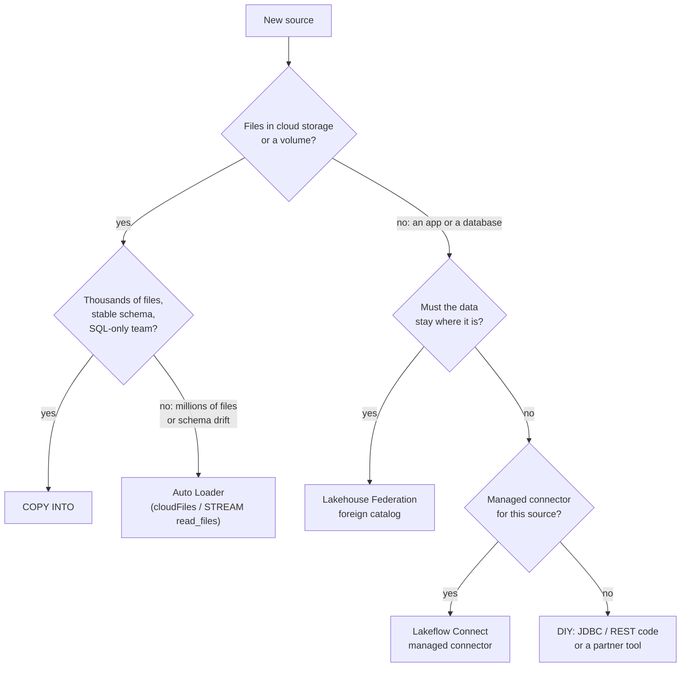

# W2 · Deep dive: Four doors into Bronze

**Sat Nov 28, 2026 (moved from Fri Nov 27) · ~45 min core + 10 min optional hands-on · closes P1 (`COPY INTO`), P2 (Auto Loader), P3 (Lakeflow Connect)**
Exam sections: **§2** Data Ingestion and Loading (main) · **§4** Working with Lakeflow Jobs · **§6** Troubleshooting, Monitoring, and Optimization · **§7** Governance and Security

> **How to use it:** one section at a time. In each 🤔 *Your call*, answer in your head before you open it. There are two ⏸ pause points, so you can split this into two sittings. Scenario-check answers are folded at the bottom.

## Contents

- **Part A · Orient:** [1 Start here](#1-start-here) · [2 The scenario and the map](#2-the-scenario-and-the-map)
- **Part B · The four doors:** [3 Supplier CSVs: `COPY INTO`](#3-door-1--supplier-price-files-with-copy-into-2) · [4 Scraper JSON: Auto Loader](#4-door-2--scraper-output-with-auto-loader-2-4) · [5 ERP and Salesforce: Lakeflow Connect](#5-door-3--erp-and-salesforce-with-lakeflow-connect-2-7) · [6 The door you don't open: federation](#6-door-4--the-one-you-dont-ingest-lakehouse-federation-2-7)
- **Part C · Lock it in:** [7 When it breaks](#7-when-it-breaks-symptom--cause--fix-6) · [8 Hands-on](#8-hands-on-optional-databricks-free-edition) · [9 Scenario check](#9-scenario-check-10-questions) · [10 Interview questions](#10-interview-questions) · [11 Cheat sheet](#11-cheat-sheet) · [12 Connections and go deeper](#12-connections-and-go-deeper)

---

## 1. Start here
*~3 min*

This closes Week 2. Each pill gave you one ingestion tool. Today you pick the right tool for **four different sources** in one realistic platform, then break each one on purpose.

| Pill | One rule | Your warm-ups |
|---|---|---|
| **P1 · `COPY INTO`** | It remembers **files**, not rows. Reruns are safe; repeated rows in new files are not. | 4/4 ✅ (recall: partial on per-file vs per-row) |
| **P2 · Auto Loader** | Infers, evolves, and stops **once** on a new column by default. | 2/4 · W1 and W2 misses |
| **P3 · Lakeflow Connect** | Most managed layer first. Apps and databases, not files. | open |

**Your misses come back on purpose:**
- `COPY INTO` is idempotent **per file, not per row** → section 3 and Q1–Q2.
- Default `addNewColumns` **stops once, then evolves** on restart → section 4 and Q3–Q4.
- `cloudFiles` reads JSON/CSV **as strings** unless `inferColumnTypes` or `schemaHints` → section 4 and Q5.

**Takeaway:** the exam's ingestion questions are mostly *"which door for this source?"* plus *"what happens when it drifts or reruns?"*. That's today.

---

## 2. The scenario and the map
*~4 min*

You run data for a procurement analytics team (sound familiar? 🙂). Four sources must reach Unity Catalog in the `procure` catalog:

| # | Source | Shape | Volume | Who cares |
|---|---|---|---|---|
| 1 | **Supplier price lists** | CSV files a supplier drops in an external volume | ~30 files/day | SQL-only pricing analysts |
| 2 | **Scraper output** | JSON files written by ~300 Airflow scrapers to a volume | ~1.5 million files/day, fields change without notice | your team |
| 3 | **ERP purchase orders** (SQL Server) and **Salesforce contracts** | Database tables and SaaS objects | Daily changes, deletes happen, PO status history matters | finance, sales |
| 4 | **Ops ticketing DB** (PostgreSQL) | Database tables | Queried a few times a month; policy says **no copies** | support leads |


<sub>Diagram drawn for this deep dive. GitHub renders it; in other viewers you'll see the Mermaid source.</sub>

| Source | Door | Lands as |
|---|---|---|
| 1 Supplier CSVs | `COPY INTO` | `procure.bronze.supplier_prices` (Delta table) |
| 2 Scraper JSON | Auto Loader | `procure.bronze.scrapes` (Delta table, via a stream) |
| 3 ERP + Salesforce | Lakeflow Connect | streaming tables in `procure.bronze_erp`, `procure.bronze_sfdc` |
| 4 Ops Postgres | Lakehouse Federation | foreign catalog `ops_pg` (no copy) |

**Takeaway:** two questions pick the door: *files or not?* and *may I copy it?* Volume and drift then pick between `COPY INTO` and Auto Loader.

---

## 3. Door 1 · Supplier price files with `COPY INTO` `§2`
*~7 min*

Thirty CSVs a day, a stable layout, and analysts who live in SQL. That's `COPY INTO`'s home: no checkpoint to manage, safe to rerun, one SQL statement in a Lakeflow Job.

```sql
CREATE TABLE IF NOT EXISTS procure.bronze.supplier_prices;

COPY INTO procure.bronze.supplier_prices
FROM (
  SELECT supplier_id,
         sku,
         CAST(price AS DECIMAL(12,2))  AS price,
         CAST(valid_from AS DATE)      AS valid_from,
         _metadata.file_name           AS source_file,   -- lineage for later dedup
         current_timestamp()           AS ingested_at
  FROM '/Volumes/procure/raw/supplier_landing/prices/'
)
FILEFORMAT = CSV
FORMAT_OPTIONS ('header' = 'true')
COPY_OPTIONS ('mergeSchema' = 'true');
```

Three things this gives you:
1. **File-level memory.** Loaded files are recorded in the table's metadata and skipped next time. A retry after a timeout loads 0 new rows.
2. **Typing at the door.** Casting in the `SELECT` means Bronze isn't all strings.
3. **`source_file`.** When something looks wrong, you can trace a row back to the file that brought it.

### 🔥 Incident: "we have duplicate prices"

The supplier "helpfully" repeats yesterday's rows inside today's file `prices_2026-11-28.csv`. Your teammate says *"impossible, `COPY INTO` is idempotent."*

<details><summary>🤔 <b>Your call:</b> is your teammate right? (This is your Tuesday recall miss.)</summary>

**Half right.** `COPY INTO` is idempotent **per file**: it will never load `prices_2026-11-27.csv` twice. But `prices_2026-11-28.csv` is a *new file*, so every row in it lands, including the repeated ones. Same for `'force' = 'true'`: the old rows stay, the reloaded rows are added.

The fix is **not** in Bronze. Bronze keeps what arrived (that's its job). Dedup happens on the way to Silver, by the **business key**.
</details>

```sql
MERGE INTO procure.silver.supplier_prices AS t
USING (
  SELECT supplier_id, sku, price, valid_from
  FROM procure.bronze.supplier_prices
  QUALIFY ROW_NUMBER() OVER (
            PARTITION BY supplier_id, sku, valid_from
            ORDER BY ingested_at DESC) = 1          -- one row per key, latest wins
) AS s
ON  t.supplier_id = s.supplier_id
AND t.sku         = s.sku
AND t.valid_from  = s.valid_from
WHEN MATCHED THEN UPDATE SET *
WHEN NOT MATCHED THEN INSERT *;
```

> 🚩 **Traps**
> - "0 rows inserted on rerun" is idempotency working, not a bug.
> - A **changed file with the same name** is skipped too. Only `FILES = (...)` + `'force' = 'true'` reloads it, and the first version's rows are still there.
> - `MERGE` fails if **two source rows match the same target row**. That's why the `QUALIFY ROW_NUMBER()` dedups the source first. Next week (W3) goes deeper on this.
> - `mergeSchema` in `COPY_OPTIONS` lets the **target** gain columns; in `FORMAT_OPTIONS` it merges schemas across **source** files.

> 📌 **Heads-up (checked Nov 28, 2026):** newer Databricks docs label `COPY INTO` as *legacy* and recommend **streaming tables** (`STREAM read_files`, section 4 option B) for SQL users who want scalable file ingestion. For a brand-new pipeline, that's the modern default. `COPY INTO` still shows up in existing code and exam scenarios, so know both and how they differ.

**Takeaway:** `COPY INTO` makes *reruns* safe. Only a key-based `MERGE` makes *rows* unique.

---

## 4. Door 2 · Scraper output with Auto Loader `§2` `§4`
*~9 min*

1.5 million JSON files a day, and scrapers that grow a new field whenever a website changes. `COPY INTO` would choke on listing that folder, and it handles drift poorly. This is Auto Loader.

You can run it two ways. Same engine underneath:

**A · Python job (you own the schema location and checkpoint):**

```python
(spark.readStream.format("cloudFiles")
   .option("cloudFiles.format", "json")
   .option("cloudFiles.schemaLocation", "/Volumes/procure/raw/_meta/scrapes/schema")
   .option("cloudFiles.inferColumnTypes", "true")              # else every JSON field is a STRING
   .option("cloudFiles.schemaHints", "price DECIMAL(12,2), scraped_at TIMESTAMP")
   # schemaEvolutionMode left at its default: addNewColumns
   .option("cloudFiles.useManagedFileEvents", "true")          # file events, not listing 1.5M files/day
   .load("/Volumes/procure/raw/scrapes/")
   .selectExpr("*", "_metadata.file_path AS source_file")
 .writeStream
   .option("checkpointLocation", "/Volumes/procure/raw/_meta/scrapes/checkpoint")
   .trigger(availableNow=True)                                  # process what's new, then stop
   .toTable("procure.bronze.scrapes"))
```

**B · SQL streaming table (the pipeline manages schema location, checkpoint and restarts):**

```sql
CREATE OR REFRESH STREAMING TABLE procure.bronze.scrapes
AS SELECT *, _metadata.file_path AS source_file
FROM STREAM read_files(
  '/Volumes/procure/raw/scrapes/',
  format => 'json',
  schemaHints => 'price DECIMAL(12,2), scraped_at TIMESTAMP'
);
```

### 🔥 Incident 1: "price is a STRING and the dashboard can't sum it"

Someone wrote option A **without** the `inferColumnTypes` line.

<details><summary>🤔 <b>Your call:</b> why STRING, and what are the two fixes? (Your Wednesday W2 miss.)</summary>

The `cloudFiles` source reads **JSON, CSV and XML columns as strings by default**, on purpose, so a field that's `"12.5"` today and `"n/a"` tomorrow doesn't break the stream. It has nothing to do with row counts. The **1,000** you remembered is the number of **files** it samples for inference (or 50 GB, whichever comes first).

Fixes: `cloudFiles.inferColumnTypes = true` (infer real types everywhere), or `cloudFiles.schemaHints = 'price DECIMAL(12,2)'` (pin just the columns you care about). Note that `read_files` (option B) infers real types by default. Exam questions saying "Auto Loader" usually mean the `cloudFiles` behaviour.
</details>

### 🔥 Incident 2: the 02:00 page

The scrapers start emitting `delivery_days`. The nightly job fails with `UnknownFieldException`. The on-call engineer opens the schema file to edit it by hand.

<details><summary>🤔 <b>Your call:</b> what actually happened, and what should on-call do? (Your Wednesday W1 miss.)</summary>

**Nothing is broken.** With no schema given, the default mode is **`addNewColumns`**. Auto Loader already **added `delivery_days` to the schema** in the schema location, *then* stopped with `UnknownFieldException` so the next run starts with the new schema. On-call should just **rerun**. Editing the schema by hand is unnecessary and risky.

It's **not** `rescue` (that keeps the schema fixed and puts the field in `_rescued_data`, and you must set it yourself), and it's **not** `failOnNewColumns` (that one *keeps* failing until a human acts).

**Make it boring:** give the Lakeflow Job task **automatic retries** (`§4`), so the stop-once is absorbed with no page. Option B (a pipeline) restarts on schema changes by itself.
</details>

| Mode | Schema changes? | Fails? | New field ends up |
|---|---|---|---|
| `addNewColumns` *(default, no schema)* | yes | **once**, restart continues | real column |
| `rescue` | never | no | `_rescued_data` |
| `failOnNewColumns` | no | yes, until fixed | nowhere yet |
| `none` *(default with a schema)* | no | no | dropped, unless `rescuedDataColumn` |

> 🚩 **Traps**
> - Auto Loader's checkpoint tracks **files**, like `COPY INTO`. Switching tools does **not** dedup repeated rows across files. Silver `MERGE` again.
> - `addNewColumns` **never changes an existing column's type**; a value that doesn't fit goes to `_rescued_data`.
> - You can't combine `addNewColumns` with a full schema you provide. Use `schemaHints` to pin some types and still evolve.
> - One **checkpoint per stream**. Two streams sharing a checkpoint corrupts progress tracking.
> - Serverless runs streams with `availableNow` only, which is perfect for a scheduled job anyway.

**Takeaway:** strings by default, evolve by stopping once, and let retries absorb the stop.

---

### ⏸ Pause point 1

Good place to stop if you're splitting this up. Before you go, say out loud: *"`COPY INTO` and Auto Loader both remember **files**. Rows are Silver's job."*

---

## 5. Door 3 · ERP and Salesforce with Lakeflow Connect `§2` `§7`
*~8 min*

These aren't files. Today an Airflow task runs `SELECT * FROM purchase_orders WHERE updated_at > :last_value`, and finance keeps finding **cancelled-and-deleted POs that still exist in Databricks**. A query-based cursor can never see a row that's gone.

<details><summary>🤔 <b>Your call:</b> which door, and why does it fix the deletes?</summary>

**A Lakeflow Connect managed SQL Server connector.** It reads changes from the database's **change log** (CDC or change tracking, turned on by the DBA), which records deletes as events. The connector applies them to the destination streaming table. Your cursor query only ever saw rows that still existed.

For Salesforce: the **managed Salesforce connector**. Same idea, no code, incremental by the API's own change markers.
</details>

**What gets built**

| Piece | SQL Server (database) | Salesforce (SaaS) |
|---|---|---|
| UC **connection** (credentials, governed with `USE CONNECTION`) | ✅ | ✅ |
| **Ingestion gateway** + **staging volume** | ✅ reads the change log continuously | ❌ calls the API directly |
| **Ingestion pipeline** on serverless → **streaming tables** | ✅ | ✅ |
| A **Lakeflow Job** per schedule | ✅ | ✅ |

```sql
-- Admin, once. Secrets, never plain passwords.
CREATE CONNECTION erp_sqlserver TYPE sqlserver
OPTIONS (host 'erp-db.internal', port '1433',
         user secret('erp', 'user'), password secret('erp', 'password'));
GRANT USE CONNECTION ON CONNECTION erp_sqlserver TO `data-eng`;
```

**History tracking: pick per table.** Finance wants *every status a PO went through*; for suppliers, only the current address matters.

| Table | Setting | Result for a PO that went `OPEN → APPROVED → SHIPPED` |
|---|---|---|
| `suppliers` | `SCD_TYPE_1` *(default)* | one row, latest values overwrite |
| `purchase_orders` | `SCD_TYPE_2` | three rows, with `__START_AT` / `__END_AT`; current one has `__END_AT IS NULL` |

```sql
SELECT po_id, status, __START_AT, __END_AT
FROM procure.bronze_erp.purchase_orders
WHERE po_id = 'PO-88812'
ORDER BY __START_AT;
```

> 🚩 **Traps**
> - Gateway + staging volume = **database** connectors only.
> - SCD type 1 is the **default**; history is off until you turn it on. A **full refresh** rebuilds the table and **wipes SCD 2 history**.
> - Source not supported by a managed connector? Drop a layer to JDBC code or a partner tool. Don't force Auto Loader onto a database.
> - Compare with `COPY INTO`: the connector applies changes **by key**, so an order that changes status three times is still one row under SCD 1, not three appended rows.

**Takeaway:** for apps and databases, buy before you build. Log-based CDC is what catches deletes.

---

## 6. Door 4 · The one you don't ingest: Lakehouse Federation `§2` `§7`
*~3 min*

Support leads query the ops PostgreSQL a few times a month, and the security policy says the data **must not be copied**. Every ingestion tool above makes a copy, so none of them fits.

```sql
CREATE CONNECTION ops_pg TYPE postgresql
OPTIONS (host 'ops-db.internal', port '5432',
         user secret('ops', 'user'), password secret('ops', 'password'));

CREATE FOREIGN CATALOG ops_pg_cat USING CONNECTION ops_pg OPTIONS (database 'ops');
GRANT USE CATALOG ON CATALOG ops_pg_cat TO `support-leads`;

SELECT status, count(*) FROM ops_pg_cat.public.tickets GROUP BY ALL;  -- runs against Postgres
```

| | Ingest (doors 1–3) | Federate (door 4) |
|---|---|---|
| Data copied? | yes | no |
| Query speed | fast, Delta | depends on the source |
| Load on the source | at ingestion time | **every** query |
| Best for | regular, heavy use | rare, ad-hoc, "no copies" |

**Takeaway:** "must not be copied" is a federation question, whatever the source is.

---

## 7. When it breaks: symptom → cause → fix `§6`
*~5 min*

| Symptom | Likely cause | Fix |
|---|---|---|
| `COPY INTO` rerun inserts 0 rows | Files already loaded (working as designed) | Nothing; new files only |
| Same price row twice in Bronze | Repeated rows in a **new** file, or a `force` reload | Dedup + `MERGE` by business key into Silver |
| Supplier re-sent a corrected file, nothing changed | Same file name → skipped | `FILES = ('…')` + `'force' = 'true'`, then dedup |
| `COPY INTO` fails after the supplier adds a column | Target table can't evolve | `COPY_OPTIONS ('mergeSchema' = 'true')` |
| Auto Loader `UnknownFieldException` once | `addNewColumns` evolved the schema | Rerun; add job retries or run in a pipeline |
| Auto Loader fails on every restart | `failOnNewColumns` | Update the schema or remove the file |
| Every scraped field is STRING | `cloudFiles` default for JSON/CSV/XML | `inferColumnTypes` or `schemaHints` |
| Weird values in `_rescued_data` | Type or case mismatch, or `rescue` mode | Inspect by `source_file`; fix upstream or add a hint |
| Micro-batches spend minutes "finding files" | Directory listing on a huge folder | File notification with file events |
| Deleted ERP rows still in Databricks | Query-based cursor can't see deletes | Log-based CDC (managed connector) |
| SCD 2 history vanished | Someone ran a full refresh | Avoid full refresh on SCD 2 tables; it's a rebuild |

```sql
-- Two quick health checks you can schedule
SELECT source_file, count(*) AS rescued_rows
FROM procure.bronze.scrapes
WHERE _rescued_data IS NOT NULL
GROUP BY ALL ORDER BY rescued_rows DESC;

DESCRIBE HISTORY procure.bronze.supplier_prices;  -- one COPY INTO per run; check numOutputRows
```

**Takeaway:** most "ingestion bugs" are a default doing exactly what it says. Know the defaults and you've solved half the exam's §2 traps.

---

### ⏸ Pause point 2

The core is done (~40 min). Hands-on is optional. The scenario check is the part that counts.

---

## 8. Hands-on (optional, Databricks Free Edition)
*~10 min · reproduces the duplicate incident and its fix*

```sql
-- Cell 1
CREATE SCHEMA IF NOT EXISTS workspace.dd_w2;
CREATE VOLUME IF NOT EXISTS workspace.dd_w2.landing;
```

```python
# Cell 2: two files, and the second repeats one row from the first
base = "/Volumes/workspace/dd_w2/landing/prices"
dbutils.fs.put(f"{base}/prices_2026-11-27.csv",
  "supplier_id,sku,price,valid_from\nS1,A-100,10.50,2026-11-27\nS1,A-200,7.25,2026-11-27\n", True)
dbutils.fs.put(f"{base}/prices_2026-11-28.csv",
  "supplier_id,sku,price,valid_from\nS1,A-200,7.25,2026-11-27\nS1,A-300,3.10,2026-11-28\n", True)
```

```sql
-- Cell 3: load twice
CREATE TABLE IF NOT EXISTS workspace.dd_w2.bronze_prices;
COPY INTO workspace.dd_w2.bronze_prices
FROM (SELECT supplier_id, sku, CAST(price AS DECIMAL(12,2)) AS price,
             CAST(valid_from AS DATE) AS valid_from, _metadata.file_name AS source_file
      FROM '/Volumes/workspace/dd_w2/landing/prices')
FILEFORMAT = CSV
FORMAT_OPTIONS ('header' = 'true')
COPY_OPTIONS ('mergeSchema' = 'true');        -- 4 rows inserted
-- Run Cell 3 again: 0 rows inserted (per-file idempotency)
SELECT sku, count(*) FROM workspace.dd_w2.bronze_prices GROUP BY sku;  -- A-200 appears twice

-- Cell 4: dedup into Silver
CREATE TABLE IF NOT EXISTS workspace.dd_w2.silver_prices
  (supplier_id STRING, sku STRING, price DECIMAL(12,2), valid_from DATE);
MERGE INTO workspace.dd_w2.silver_prices t
USING (SELECT supplier_id, sku, price, valid_from
       FROM workspace.dd_w2.bronze_prices
       QUALIFY ROW_NUMBER() OVER (PARTITION BY supplier_id, sku, valid_from
                                  ORDER BY source_file DESC) = 1) s
ON t.supplier_id = s.supplier_id AND t.sku = s.sku AND t.valid_from = s.valid_from
WHEN MATCHED THEN UPDATE SET *
WHEN NOT MATCHED THEN INSERT *;
SELECT * FROM workspace.dd_w2.silver_prices;   -- 3 rows
-- Run the MERGE again: still 3 rows (this step is idempotent per row)

-- Cell 5: clean up
DROP SCHEMA workspace.dd_w2 CASCADE;
```

For the Auto Loader side (stop once, then evolve), Wednesday's hands-on already has a ready-made cell: [P2 §7](02-wed-auto-loader-and-schema-evolution.md#7-optional-hands-on-10-min).

---

## 9. Scenario check (10 questions)
*~8 min · answers at the bottom*

Reply with your answers (e.g. `Q1 B, Q2 C …`). Misses go into Monday's review, tagged by section.

**Q1.** `§2` Today's supplier file `prices_2026-11-28.csv` repeats 40 rows from yesterday's file. The nightly `COPY INTO` runs once. What lands in Bronze?
- A) Only the new rows, since `COPY INTO` skips rows it already loaded
- B) Every row in the new file, including the 40 repeated ones
- C) Nothing, because the load fails with a duplicate-key error
- D) Only the new rows, as long as `mergeSchema` is turned on

**Q2.** `§2` `§3` You want one row per `(supplier_id, sku, valid_from)` downstream, and Bronze must keep exactly what arrived. Where and how?
- A) In Bronze, by adding `'force' = 'false'` to every `COPY INTO`
- B) In Bronze, by switching the load from `COPY INTO` to Auto Loader
- C) In Silver, with a source dedup and a `MERGE` on the business key
- D) In Bronze, by running `VALIDATE ALL` before every scheduled load

**Q3.** `§2` A Python `cloudFiles` job reads JSON with `schemaLocation` set, no schema, other options default. It runs in a Lakeflow Job with **no retries**. Scrapers add `delivery_days`. What do you find in the morning?
- A) The run failed once; the stored schema already has the column, so a rerun works
- B) The run succeeded; `delivery_days` sits in `_rescued_data` until someone adds it
- C) The run succeeded, and `delivery_days` was quietly dropped from every new row
- D) The run failed, and it keeps failing until someone edits the schema file by hand

**Q4.** `§4` Same job. What is the smallest change so the next new field doesn't page anyone, while the column still gets added?
- A) Switch `schemaEvolutionMode` to `failOnNewColumns`
- B) Raise `cloudFiles.maxFilesPerTrigger` for each run
- C) Switch `schemaEvolutionMode` to `rescue` for good
- D) Turn on automatic retries for the job's task

**Q5.** `§2` In that Bronze table every scraped field is `STRING`. You want `price` as `DECIMAL(12,2)` without writing out the whole schema. What do you set?
- A) A full `StructType` schema on the reader, with `price` typed
- B) `cloudFiles.schemaHints` = `'price DECIMAL(12,2)'`
- C) A larger inference sample, above the 1,000-row default
- D) `cloudFiles.schemaEvolutionMode` = `'addNewColumns'`

**Q6.** `§2` Finance needs every status each purchase order went through, from the ERP's SQL Server, with little code. What do you configure?
- A) A managed SQL Server connector, keeping the default SCD type 1
- B) Auto Loader over nightly CSV exports, appending every run
- C) A managed SQL Server connector with history tracking on (SCD 2)
- D) A foreign catalog over SQL Server, queried with time travel

**Q7.** `§2` You set up the managed **Salesforce** connector. Which of these is **not** created?
- A) An ingestion gateway with its staging volume
- B) A Unity Catalog connection holding the credentials
- C) An ingestion pipeline that writes streaming tables
- D) A Lakeflow Job for the schedule you add

**Q8.** `§2` `§7` Support leads query the ops PostgreSQL a few times a month, and policy forbids copies. What do you set up?
- A) A managed PostgreSQL connector on a weekly schedule
- B) A JDBC read in a notebook that saves to a Delta table
- C) Auto Loader over nightly `pg_dump` files in a volume
- D) A UC connection and a foreign catalog on top of it

**Q9.** `§2` Pricing analysts (SQL only) get ~30 CSV files a day with a stable layout. They want a scheduled load that's safe to rerun with no checkpoint to manage. What fits best?
- A) A Python Auto Loader job with file notification mode
- B) A `COPY INTO` statement scheduled in a Lakeflow Job
- C) A CTAS over `read_files` that rebuilds the table nightly
- D) A managed connector pointed at the supplier volume

**Q10.** `§6` An Airflow task loads ERP orders with `WHERE updated_at > :last_value` and appends. Orders deleted in SQL Server stay in Databricks for weeks. What's the cause?
- A) Delta keeps deleted rows until `VACUUM` removes their files
- B) The append needs `mergeSchema` to apply the source deletes
- C) A query-based cursor can't see rows that no longer exist
- D) Change tracking is on, but the Airflow retries undo deletes

<details><summary><b>Answers (open after you've answered all 10)</b></summary>

**Q1 → B** (§2). `COPY INTO` is idempotent **per file**. A new file name is new, so all its rows land.
- A) It tracks files, not rows. This was your Tuesday recall miss.
- C) Delta tables don't enforce primary keys, so nothing fails.
- D) `mergeSchema` is about new columns, not repeated rows.

**Q2 → C** (§2 §3). Bronze keeps what arrived; Silver dedups the source (`ROW_NUMBER`/`QUALIFY`) and `MERGE`s on the key.
- A) There's no `force = false` dedup; `force` only controls file skipping.
- B) Auto Loader's checkpoint also tracks files, so repeated rows still land.
- D) `VALIDATE` is a dry run; it loads and drops nothing.

**Q3 → A** (§2). Default `addNewColumns`: schema updated first, `UnknownFieldException` once, the next run continues with the column.
- B) That's `rescue` mode, which you must set yourself (your Wednesday W1 miss).
- C) Dropping new fields is `none`, the default only when you provide a schema.
- D) "Keeps failing until a human acts" is `failOnNewColumns`.

**Q4 → D** (§4). Retries rerun the task, and the rerun picks up the already-evolved schema.
- A) That makes it fail *more*: every new field needs a human.
- B) Batch size has nothing to do with schema changes.
- C) `rescue` stops the failure but the column is never added, which breaks the requirement.

**Q5 → B** (§2). `schemaHints` pins the types you name and leaves the rest to inference and evolution.
- A) Works for typing, but it's the whole schema, and a provided schema blocks `addNewColumns`.
- C) The sample is up to 1,000 **files** (or 50 GB), not rows, and size doesn't change the string default (your Wednesday W2 miss).
- D) `addNewColumns` is already the default and controls new columns, not types.

**Q6 → C** (§2). History tracking on = SCD type 2: one row per version with `__START_AT` / `__END_AT`.
- A) SCD 1 overwrites, so earlier statuses are lost.
- B) Exports plus appends is DIY, misses deletes, and duplicates unchanged rows.
- D) Federation doesn't keep history, and time travel is a Delta feature, not SQL Server's.

**Q7 → A** (§2). Gateway + staging volume are for **database** connectors; SaaS connectors call the API directly.
- B) Every managed connector uses a UC connection.
- C) Every managed connector writes streaming tables through a pipeline.
- D) Every schedule creates a Lakeflow Job.

**Q8 → D** (§2 §7). Lakehouse Federation: a connection plus a foreign catalog; queries run against Postgres.
- A) A connector copies the data.
- B) Saving to Delta is a copy.
- C) Dump files are a copy too, and stale by design.

**Q9 → B** (§2). Thousands of files, stable layout, SQL-only, rerun-safe: `COPY INTO`.
- A) Works, but it's Python and adds a checkpoint and schema location to manage.
- C) A nightly rebuild isn't incremental; it rereads everything.
- D) Managed connectors are for apps and databases, not files in a volume.
- Note: a SQL streaming table over `read_files` would also fit (and is what current docs recommend for new pipelines), but it isn't among the options.

**Q10 → C** (§6). `WHERE updated_at > …` only returns rows that exist; a deleted row simply vanishes from the result.
- A) `VACUUM` removes old files for time travel; current reads already exclude deleted rows.
- B) `mergeSchema` adds columns; it never applies deletes.
- D) Retries don't undo deletes, and the cursor query never reads change tracking.

</details>

---

## 10. Interview questions

<details><summary><b>"Walk me through how you'd pick an ingestion method for a new source."</b></summary>

Two questions first: *Is it files or a system?* and *May we copy it?* If we can't copy, federation. Systems with a managed connector get Lakeflow Connect, because CDC, retries and schema changes are someone else's job. Files: `COPY INTO` for thousands of files and a SQL team, Auto Loader for millions or drift. Close with the cost of the alternative: "I run ~300 Airflow scrapers because those sources have no connector. That's real upkeep, so I only build when I can't buy."
</details>

<details><summary><b>"Your ingestion is idempotent. Why do you still have duplicates?"</b></summary>

Because idempotency is usually at the **file or batch** level. `COPY INTO` and Auto Loader both remember files, so retries are safe, but the same business record in two files lands twice. Exactly-once on rows comes from an idempotent **sink**: dedup by business key and `MERGE` into Silver. Bonus: keep `source_file` in Bronze so you can prove where a duplicate came from.
</details>

<details><summary><b>"A source team keeps adding fields. How do you stop that from waking you up?"</b></summary>

Evolve in Bronze (Auto Loader `addNewColumns`), wrap it in job retries or a pipeline so the stop-once is invisible, keep `_rescued_data` for type mismatches, and alert on `_rescued_data IS NOT NULL`. Silver keeps an explicit schema, so a new field becomes a reviewed change rather than a surprise on a dashboard.
</details>

---

## 11. Cheat sheet

| Door | Use when | Memory of progress | Drift handling | Watch out |
|---|---|---|---|---|
| **`COPY INTO`** | thousands of files, SQL team | loaded-file list in table metadata | `mergeSchema` in `COPY_OPTIONS` | per **file**, not per row; same-name file skipped |
| **Auto Loader** (`cloudFiles` / `STREAM read_files`) | millions of files, drift, streaming | checkpoint (files) + schema location | `addNewColumns` default: stop once, then evolve | `cloudFiles` JSON/CSV/XML = **strings** unless `inferColumnTypes`/`schemaHints` |
| **Lakeflow Connect** managed | SaaS apps, databases | connector cursor / CDC | handled by connector (renames need full refresh) | SCD 1 default; full refresh wipes SCD 2; gateway = DB only |
| **Federation** | must not copy, rare queries | n/a | n/a | every query hits the source |

**Numbers:** inference samples up to **1,000 files or 50 GB** · `FILES` list up to **1,000 files** · UI file upload **5 GB** per file · managed connector up to **250 tables** per pipeline.

**Don't confuse:** `rescue` (fixed schema, keep data, no failure) vs `none` (fixed schema, drop data) · `FORMAT_OPTIONS mergeSchema` (read) vs `COPY_OPTIONS mergeSchema` (target) · `VALIDATE` (dry run) vs `force` (reload) · ingest (copy) vs federate (no copy).

---

## 12. Connections and go deeper

- **Back to W1:** Bronze tables here are **managed** tables (no `LOCATION`), while the landing volumes sit on **external locations** owned by the sources. Connections are another UC securable, governed with grants like external locations.
- **Next week (W3, Bronze → Silver):** the `MERGE` dedup from section 3 grows into data quality, joins, and SCDs in your own models. The SCD 2 output from section 5 is a preview of Friday's star schema deep dive.
- **Your older notes:** [Schema enforcement vs evolution on Delta](../../../explanations/schema-enforcement-and-evolution.md) · [Medallion architecture](../../../explanations/medallion-architecture.md) · [UC volumes and external locations](../../../explanations/unity-catalog-volumes-and-external-locations.md) · [Structured Streaming course notes](../../../courses/structured-streaming/02-spark-structured-streaming.html)
- **This week's pills:** [P1 `COPY INTO`](01-tue-batch-streaming-incremental-copy-into.md) · [P2 Auto Loader](02-wed-auto-loader-and-schema-evolution.md) · [P3 Lakeflow Connect](03-thu-lakeflow-connect-managed-connectors.md)

**Official docs**
- [COPY INTO (SQL reference)](https://docs.databricks.com/aws/en/sql/language-manual/delta-copy-into)
- [Schema inference and evolution in Auto Loader](https://docs.databricks.com/aws/en/ingestion/cloud-object-storage/auto-loader/schema)
- [Auto Loader file detection modes](https://docs.databricks.com/aws/en/ingestion/cloud-object-storage/auto-loader/file-detection-modes)
- [File metadata column (`_metadata`)](https://docs.databricks.com/aws/en/ingestion/file-metadata-column)
- [Lakeflow Connect connector concepts](https://docs.databricks.com/aws/en/ingestion/lakeflow-connect/)
- [Enable history tracking (SCD type 2)](https://docs.databricks.com/aws/en/ingestion/lakeflow-connect/scd)
- [What is Lakehouse Federation?](https://docs.databricks.com/aws/en/query-federation/)
- [MERGE INTO](https://docs.databricks.com/aws/en/sql/language-manual/delta-merge-into)
- [Exam guide](https://www.databricks.com/learn/certification/data-engineer-associate)

---
*Reply with your answers (e.g. `Q1 B, Q2 C …`). Misses go into Monday's Week 3 review, tagged by exam section. Enjoy the rest of your weekend after this one. 🌴*
