# W1 · Friday deep dive: Anatomy of a governed table (v2)

**Fri Nov 20, 2026 (rebuilt Nov 22) · ~65 min core + 10 min optional hands-on · closes P1 (Delta/ACID), P2 (compute), P3 (Unity Catalog)**
Exam sections: **§1** Databricks Intelligence Platform · **§2** Data Ingestion and Loading · **§3** Data Transformation and Modeling · **§6** Troubleshooting, Monitoring, and Optimization · **§7** Governance and Security

> **Best experience:** download [`deepdive-anatomy-of-a-governed-table.html`](deepdive-anatomy-of-a-governed-table.html) together with the `assets/deepdive-w1/` folder and open it in a browser. It has the same content with progress tracking, a step-by-step walkthrough, clickable quiz answers and a printable cheat sheet. This Markdown copy is for reading on GitHub.
>
> **How to use it:** one section at a time. In each 🤔 *Your call*, answer in your head before you open it. There are two ⏸ pause points. Scenario-check answers are folded at the bottom.

## Contents

- **Part A · Orient:** [1 Start here](#1-start-here) · [2 The map](#2-the-map)
- **Part B · The four layers:** [3 Platform and compute](#3-layer-1--platform-and-compute-1) · [4 Unity Catalog and privileges](#4-layer-2--unity-catalog-objects-and-privileges-7) · [5 Storage](#5-layer-3--storage-credentials-locations-volumes-managed-storage-7-2) · [6 Delta log](#6-layer-4--delta-log-checkpoints-concurrency-1-6)
- **Part C · Put it together:** [7 Walkthrough](#7-walkthrough-the-vendor-feed-in-6-steps-2-3-7) · [8 Safety nets](#8-safety-nets-and-lifecycle-6-7) · [9 When it breaks](#9-when-it-breaks-errors-to-recognise-6)
- **Part D · Lock it in:** [10 Hands-on](#10-hands-on-optional-databricks-free-edition) · [11 Scenario check](#11-scenario-check-11-questions) · [12 Interview questions](#12-interview-questions) · [13 Cheat sheet](#13-cheat-sheet) · [14 Connections and go deeper](#14-connections-and-go-deeper)

---

## 1. Start here
*~4 min*

This closes Week 1. P1, P2 and P3 each gave you one layer. Today you stack them (**platform → catalog → storage → Delta log**), then run one realistic scenario through all four layers and break it on purpose.

| Pill | One rule | Your warm-ups |
|---|---|---|
| **P1 · Delta + ACID** | A write is visible only when its commit lands in `_delta_log`. | 4/4 ✅ |
| **P2 · Compute** | Storage never moves; you pick the engine per job. | 3/4 · W4 miss (init scripts) → §3 |
| **P3 · Unity Catalog** | UC always owns the metadata. Managed means UC owns the files too. | 3/4 · W3 miss (RESTORE vs UNDROP) → §8 |

**Your misses come back on purpose:**
- Diagnostic Q6 (§3, plain vs materialized view) → walkthrough step 5.
- P2 W4 (§1, serverless limits) → section 3.
- P3 W3 (§7, `RESTORE` vs `UNDROP`) → section 8 and the scenario check.

**Takeaway:** one table, four layers. If you can say what each layer does when something goes wrong, you understand the table.

---

## 2. The map
*~3 min*

A vendor drops daily CSV order files into **their own** S3 bucket. You make them reachable with governance, load a Bronze Delta table, and give analysts a small Gold object.

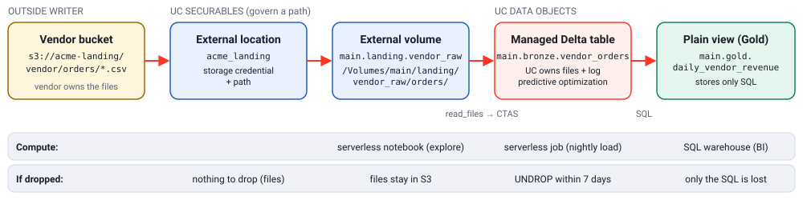
<sub>Diagram drawn for this deep dive.</sub>

| | Volume | Bronze table | Gold view |
|---|---|---|---|
| **Compute** | serverless notebook (explore) | serverless job (nightly load) | SQL warehouse (BI) |
| **If dropped** | files stay in S3 | `UNDROP` within 7 days | only the SQL is lost |

| Layer | Question it answers | Section |
|---|---|---|
| Platform / compute | What engine runs my code, and where? | 3 |
| Catalog (Unity Catalog) | What exists, what's it called, who may touch it? | 4 |
| Storage | Where do the bytes live, and who owns their lifecycle? | 5 |
| Delta log | Which files make up version N, and how do writers agree? | 6 |

**Takeaway:** the vendor owns the *files*; your pipeline owns the *table*. That split decides external vs managed everywhere on this page.

---

## 3. Layer 1 · Platform and compute `§1`
*~6 min*

Databricks has two parts. The **control plane** holds the web app, job orchestration, Unity Catalog, and your queries and code. The **compute plane** is where the work runs. Classic compute runs in *your* cloud account; serverless compute runs in Databricks' account. Your data stays in your storage either way.

| Classic + serverless | Serverless workspace |
|---|---|
| 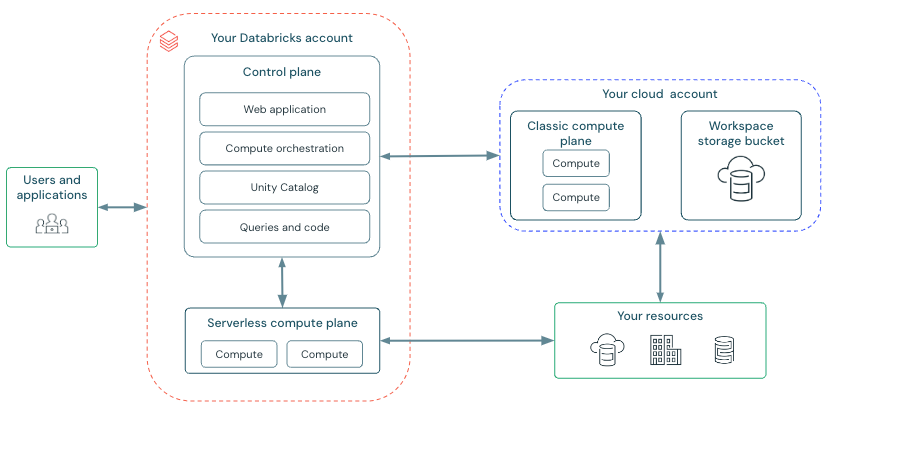 | 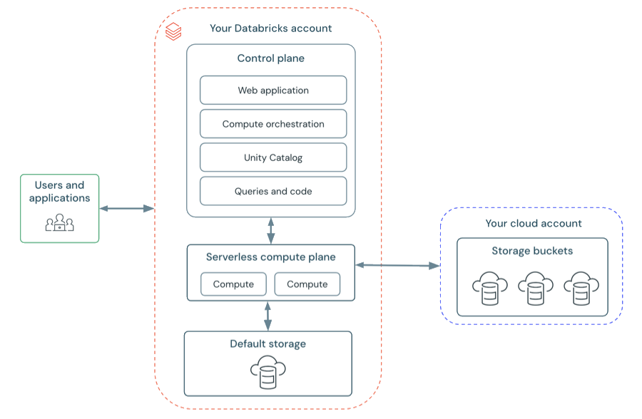 |
| *Classic compute lives in your account next to the workspace bucket.* | *Compute runs in Databricks' account; default storage can be Databricks-managed.* |

<sub>Official diagrams. Source: [Databricks docs · High-level architecture](https://docs.databricks.com/aws/en/getting-started/high-level-architecture)</sub>

This is the P2 idea as a picture: storage never moves, and any engine can point at the same table, because **Unity Catalog in the control plane** tells each engine what the table is and whether you're allowed in.

### Pick the engine

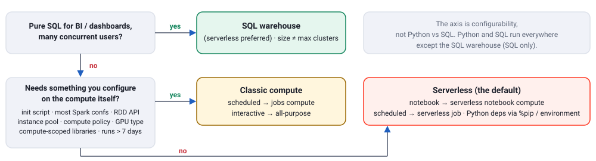
<sub>Diagram drawn for this deep dive.</sub>

The deciding question is **how much you need to configure the compute**, not Python vs SQL. Python and SQL run on every compute type except the SQL warehouse, which is SQL only.

### Serverless limits worth memorising
Checked against [Serverless compute limitations](https://docs.databricks.com/aws/en/compute/serverless/limitations) (page updated Nov 17, 2026).

**You can't configure the compute:**
- No **compute-scoped init scripts**. Install Python packages with `%pip` or the environment panel (P2 W4).
- **Most Spark configs** can't be set; only a supported list can.
- No compute policies, instance pools, compute-scoped libraries or env vars.
- Max runtime is **7 days**.

**It behaves a bit differently:**
- It's **Spark Connect only**: DataFrame APIs work, RDD APIs don't.
- There's **no Spark UI**; you use the **query profile** instead.
- Streaming accepts only the `availableNow` trigger (or the deprecated `once`).
- ANSI mode is on, and the session time zone is UTC.
- `%pip` installs vanish when the session ends.
- Data access goes through Unity Catalog.

<details><summary>🤔 <b>Your call:</b> a nightly Python job reads from an internal system whose JDBC driver is installed by your platform team's init script. Serverless or classic?</summary>

**Classic jobs compute.** The blocker isn't Python or JDBC. It's the **init script**, which serverless doesn't run. If the driver came in as a normal Python package (`%pip`), or the source had a Lakeflow Connect connector, serverless would be fine.
</details>

> ⚠️ **Exam trap:** "use a larger serverless environment" or "run it on a SQL warehouse" sound plausible. Neither one adds init scripts, and a SQL warehouse can't run a Python task.

Cost check: `SELECT sku_name, usage_date, SUM(usage_quantity) AS dbus FROM system.billing.usage GROUP BY ALL ORDER BY usage_date DESC`. Older note: [Spark parallelism on single-node and serverless](../../explanations/spark-parallelism-single-node-and-serverless.md).

**Takeaway:** serverless by default; classic only when you must configure the machine.

---

## 4. Layer 2 · Unity Catalog: objects and privileges `§7`
*~7 min*

Every table is `catalog.schema.object` inside one **metastore** (one per region). Next to the catalogs sit the securables that govern access to things *outside*: storage credentials, external locations, connections and shares.

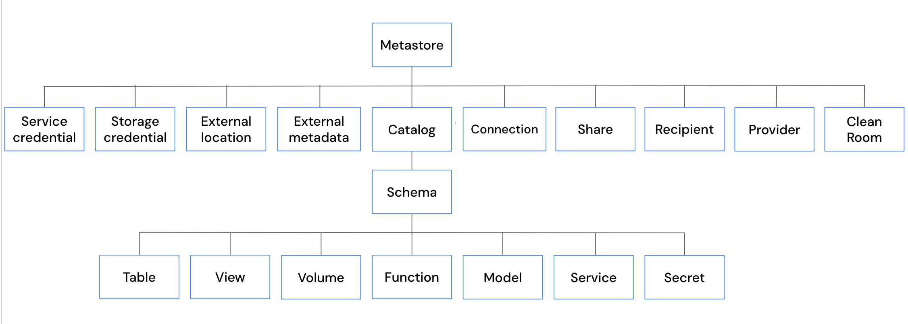
<sub>Official. Data objects sit under catalog → schema; credentials and external locations hang off the metastore. Source: [Databricks docs · What is Unity Catalog?](https://docs.databricks.com/aws/en/data-governance/unity-catalog/)</sub>

### How privileges flow: inheritance + usage gates

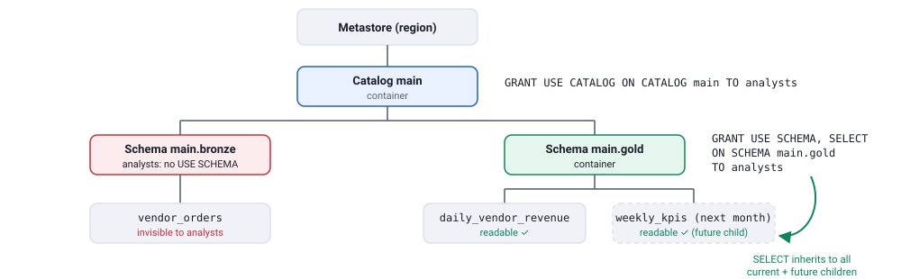
<sub>Diagram drawn for this deep dive.</sub>

- **Inheritance:** a privilege on a **container** (catalog, schema) applies to all its **current and future** children.
- **Usage gates:** reading `main.gold.x` needs **all three**: `USE CATALOG` on `main`, `USE SCHEMA` on `main.gold`, and `SELECT` on `x` (direct or inherited). A table owner can't bypass the gates.

| To do this… | …you need (besides USE CATALOG + USE SCHEMA) |
|---|---|
| Read a table or view | `SELECT` on it (or on its schema/catalog) |
| Create a managed table | `CREATE TABLE` on the schema |
| Create an external table at a path | `CREATE TABLE` on the schema + `CREATE EXTERNAL TABLE` on the external location (P3 W2) |
| Create an external volume | `CREATE VOLUME` on the schema + `CREATE EXTERNAL VOLUME` on the external location |
| List / read files in a volume | `READ VOLUME` (writing needs `WRITE VOLUME`) |
| See that objects exist, without data | `BROWSE` on the catalog (no usage gates needed) |
| Grant, revoke, transfer ownership | Owner, or `MANAGE` on the object |

> 🚩 **Traps**
> - **All users have `USE CATALOG` on `main` by default.** In a "can't read the view" question about `main`, the missing piece is usually `USE SCHEMA`.
> - **Views run with the owner's rights** on the underlying tables (on serverless, SQL warehouses and standard compute). Analysts need `SELECT` on the *view*, not on Bronze. If the owner loses `SELECT` on Bronze, the view breaks for everyone.
> - `MODIFY` lets you change data. It never helps a read.

```sql
SHOW GRANTS ON SCHEMA main.gold;
SHOW GRANTS `analysts` ON VIEW main.gold.daily_vendor_revenue;
GRANT BROWSE ON CATALOG main TO `account users`;   -- discoverable, no data access
```

<details><summary>🤔 <b>Your call:</b> an analyst has <code>SELECT</code> on the Gold view but gets INSUFFICIENT_PERMISSIONS. The view owner's Bronze grants are fine. What's missing?</summary>

**`USE SCHEMA` on `main.gold`.** `USE CATALOG` on `main` is also needed, but everyone has it by default. `SELECT` alone never opens the containers. `MODIFY` is for writes, and nothing on Bronze is needed because the view runs with its owner's rights.
</details>

**Takeaway:** grants flow down, and the usage gates must be open at every level above the object.

---

## 5. Layer 3 · Storage: credentials, locations, volumes, managed storage `§7` `§2`
*~6 min*

- A **storage credential** wraps a cloud identity (an IAM role on AWS).
- An **external location** pairs a credential with a path.
- External tables, external volumes and managed storage roots are all created *under* external locations.

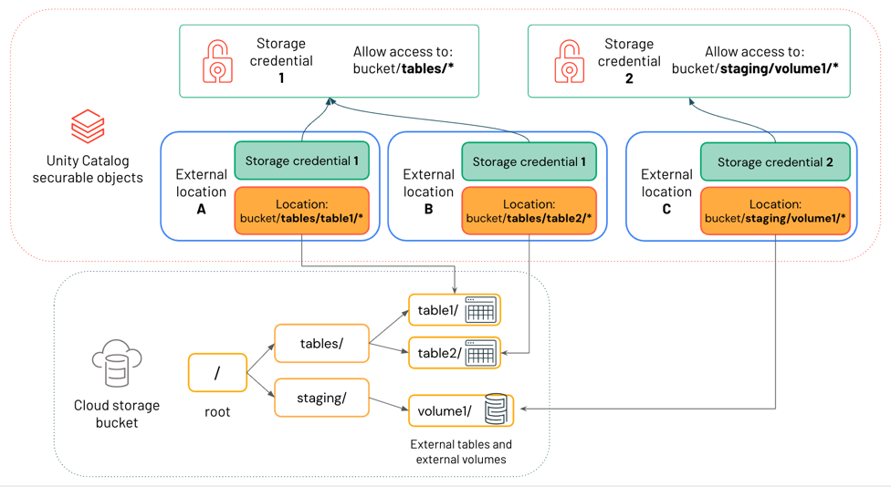
<sub>Official. One credential can back several locations; each location governs one path. Source: [Databricks docs · External locations](https://docs.databricks.com/aws/en/connect/unity-catalog/cloud-storage/external-locations)</sub>

### Where a managed table's data goes: the most specific root wins

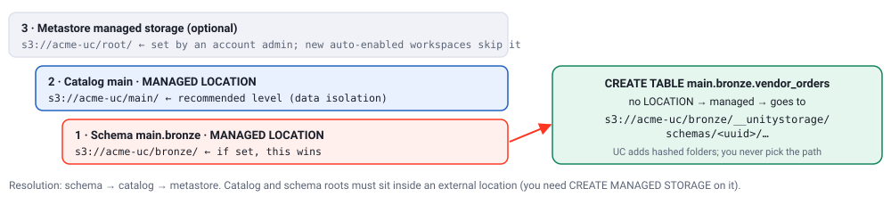
<sub>Diagram drawn for this deep dive.</sub>

- Databricks recommends setting the root at the **catalog** level, for data isolation.
- Catalog and schema roots must sit inside an external location, and you need `CREATE MANAGED STORAGE` on it.

> 🚩 **Traps**
> - **Paths can't overlap.** Managed storage, external tables and external volumes each need their own path, or you get `LOCATION_OVERLAP`.
> - `ALTER SCHEMA … SET MANAGED LOCATION` affects only **new** objects.
> - Where the *source files* came from never decides managed vs external. Only `LOCATION` does.

### Volumes: governed files, not tables

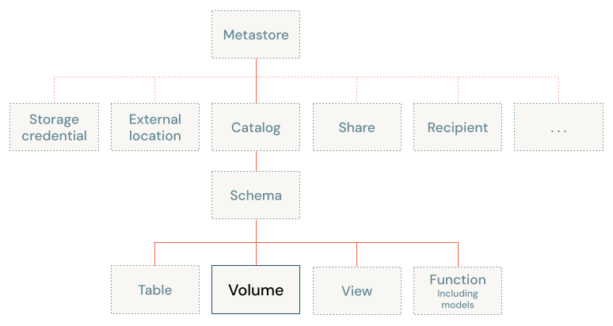
<sub>Official. A volume is a schema-level sibling of a table. Source: [Databricks docs · Volumes](https://docs.databricks.com/aws/en/volumes/)</sub>

| | Managed volume | External volume |
|---|---|---|
| Files live | In the schema's managed storage | At an existing path under an external location |
| `DROP VOLUME` | UC deletes the files (7-day retention) | **Files stay** in cloud storage |
| Access | Only through UC | UC governs access; outside tools can use the URI |
| Fits | Files your own pipelines create | Landing zones others write to (our vendor) |

The path format is `/Volumes/<catalog>/<schema>/<volume>/<path>`. You can't list `/Volumes/main` on its own, and you **can't register volume files as a table**. You read them into one.

```sql
-- Admin, once
CREATE EXTERNAL LOCATION IF NOT EXISTS acme_landing
  URL 's3://acme-landing/' WITH (STORAGE CREDENTIAL acme_landing_role);
GRANT CREATE EXTERNAL VOLUME ON EXTERNAL LOCATION acme_landing TO `data-engineers`;

-- You: govern the vendor's folder in place
CREATE SCHEMA IF NOT EXISTS main.landing;
CREATE EXTERNAL VOLUME main.landing.vendor_raw LOCATION 's3://acme-landing/vendor/';
GRANT READ VOLUME ON VOLUME main.landing.vendor_raw TO `data-engineers`;
LIST '/Volumes/main/landing/vendor_raw/orders/';
```

```python
display(dbutils.fs.ls("/Volumes/main/landing/vendor_raw/orders/"))
df = spark.read.option("header", True).csv("/Volumes/main/landing/vendor_raw/orders/")
```

<details><summary>🤔 <b>Your call:</b> why an external volume, and not a managed one or an external table over the CSVs?</summary>

The vendor keeps **writing** into their own bucket, so the files have an outside owner. You govern them in place.
- A **managed volume** would mean copying the files into UC storage, which the vendor can't write to.
- An **external table** governs rows, not files. It wouldn't give you `/Volumes` file access for inspection, reprocessing, or Auto Loader next week.
</details>

Older note: [UC volumes, storage credentials and external locations](../../explanations/unity-catalog-volumes-and-external-locations.md).

**Takeaway:** credentials and locations govern *paths*, volumes govern *files*, and tables govern *rows*. Managed data lands at the most specific managed root.

---

## 6. Layer 4 · Delta log, checkpoints, concurrency `§1` `§6`
*~7 min*

A Delta table is Parquet data files plus a `_delta_log/` folder.
- Each successful write adds exactly **one** numbered commit file.
- Version N is every file that commits 0…N added and didn't later remove.

| Table folder = log + data files | Checkpoints save replaying |
|---|---|
| 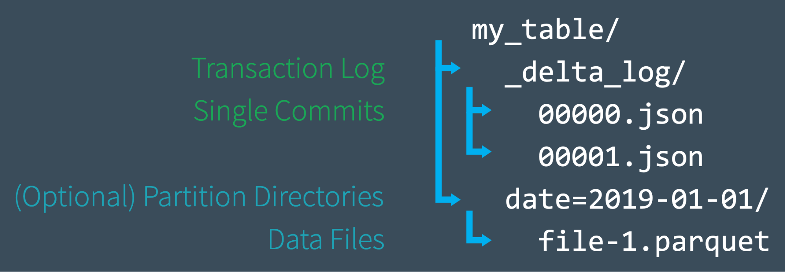 | 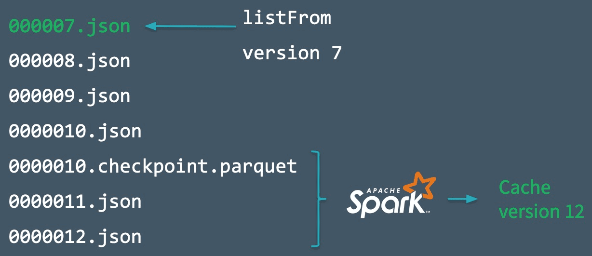 |

<sub>Official, from the Databricks blog: [Diving into Delta Lake: Unpacking the transaction log](https://www.databricks.com/blog/2019/08/21/diving-into-delta-lake-unpacking-the-transaction-log.html). The post is from 2019. Partition folders are optional, and its "checkpoint every 10 commits" is the classic open-source default; Databricks now tunes checkpoint frequency itself ([History and data retention](https://docs.databricks.com/aws/en/delta/history)).</sub>

**What one commit contains** (illustrative, trimmed):

```json
// _delta_log/00000000000000000008.json, the nightly append, one action per line
{"commitInfo":{"operation":"WRITE","operationParameters":{"mode":"Append"},"isBlindAppend":true}}
{"add":{"path":"part-00000-3f1c….snappy.parquet","size":48213,"dataChange":true,"stats":"{\"numRecords\":5120,…}"}}
{"add":{"path":"part-00001-9a2e….snappy.parquet","size":47790,"dataChange":true,"stats":"{\"numRecords\":5004,…}"}}
// UPDATE writes "remove" + "add"; schema/property changes write "metaData"; feature upgrades write "protocol"
```

- **UPDATE and DELETE don't delete old files.** The log only *marks* them as removed. That's why time travel and `RESTORE` work, and why `VACUUM` exists.
- **Per-file stats** (row counts, min/max) live in the log, so engines can skip files without opening them (data skipping, W4).

### Atomic commits and optimistic concurrency

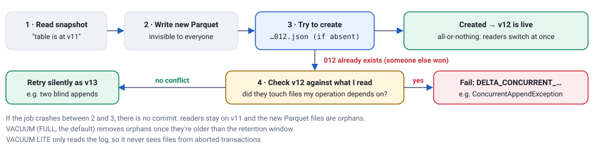
<sub>Diagram drawn for this deep dive.</sub>

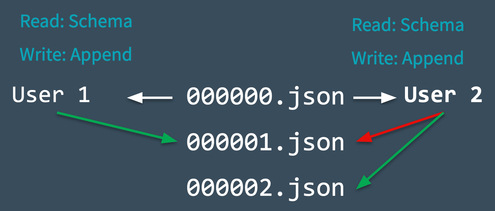
<sub>Official, from the Databricks blog (same post). Both users read v0. User 1 wins v1; user 2's attempt at v1 fails, it finds no logical conflict, and it commits v2.</sub>

- **Crash between steps 2 and 3:** no commit is written, so readers stay on v11 and the new files become orphans. `VACUUM` in FULL mode (the default) removes them once they're past retention. **LITE** mode reads only the log, so it never sees them.
- **Default isolation is WriteSerializable.** Appends that don't read the table **never conflict**.
- **Conflicts** happen when an `UPDATE`, `DELETE` or `MERGE` read data that a concurrent commit changed. Row-level concurrency (with deletion vectors) narrows this to real row overlaps.
- **Metadata changes** (`ADD COLUMNS`, table properties) can fail *all* concurrent writers and stop streaming readers.
- **Readers never block.** There's no half-written state to repair. `FSCK REPAIR TABLE` is for a different problem: data files deleted by hand.

<details><summary>🤔 <b>Your call:</b> two nightly jobs append to Bronze at the same second, and one also runs a MERGE that reads yesterday's rows. Which one can fail?</summary>

Both plain appends succeed; the one that loses the race retries as the next version. The **MERGE** is the one that can fail with a concurrent-modification error, because it *read* data that may have changed under it. To fix it, narrow the MERGE condition, schedule the jobs apart, or retry.
</details>

Older notes: [ACID on Delta](../../explanations/acid-on-delta.md) · [Course: Using Apache Spark with Delta Lake](../../courses/monitoring-and-optimization/02-using-apache-spark-with-delta-lake.html).

**Takeaway:** a commit is one atomic file creation, so no commit means no change. Writers race optimistically, and only real overlaps fail.

> ⏸ **Pause point 1.** You've finished the four layers (~26 min). Take five minutes, or stop here and come back to Part C another day.

---

## 7. Walkthrough: the vendor feed in 6 steps `§2` `§3` `§7`
*~8 min*

**Step 1 · Land (storage).** Done in section 5: the `acme_landing` location plus the external volume `main.landing.vendor_raw`. Engineers browse `/Volumes/...` with `READ VOLUME`. *Why it matters later:* the raw files stay in the vendor's bucket, so you can rebuild Bronze from them even after the `UNDROP` window has passed.

**Step 2 · Compute (platform).**

| Work | Compute | Why |
|---|---|---|
| Explore files (Python + SQL) | Serverless notebook | Starts in seconds, nothing to size |
| Nightly Bronze load | Serverless job | Short, scheduled, no idle cost |
| Analysts on the Gold view | Serverless SQL warehouse | Built for SQL and BI concurrency |
| Legacy task with an init script | Classic jobs compute | Serverless doesn't run init scripts |

**Step 3 · Load Bronze as a managed table (storage).** The files have an outside owner, but the table is yours. Leaving out `LOCATION` makes it managed, so it gets predictive optimization, automatic cleanup and `UNDROP`.

```sql
CREATE TABLE IF NOT EXISTS main.bronze.vendor_orders AS
SELECT *,
       _metadata.file_path AS source_file,      -- lineage: which CSV each row came from
       current_timestamp() AS ingested_at
FROM read_files('/Volumes/main/landing/vendor_raw/orders/', format => 'csv', header => true);
-- read_files adds _rescued_data by default for values that don't fit the inferred schema
DESCRIBE TABLE EXTENDED main.bronze.vendor_orders;   -- Type: MANAGED
```

```python
from pyspark.sql import functions as F
(spark.read.option("header", True).csv("/Volumes/main/landing/vendor_raw/orders/")
   .select("*", F.col("_metadata.file_path").alias("source_file"))
   .withColumn("ingested_at", F.current_timestamp())
   .write.saveAsTable("main.bronze.vendor_orders"))      # no .option("path") → managed
```

> **Bridge to W2:** a CTAS is fine once, but re-run nightly it would re-read every file. Next week swaps it for `COPY INTO` and Auto Loader, which pick up only new files.

**Step 4 · A bad Wednesday (Delta log).**
- (a) The load crashes mid-write while analysts are querying. There's no commit, so they keep seeing the last version.
- (b) A teammate runs `UPDATE main.bronze.vendor_orders SET amount = 0 WHERE vendor_id = 42;` against the wrong vendor.

```sql
DESCRIBE HISTORY main.bronze.vendor_orders;                -- UPDATE at v8 → good version is 7
SELECT count(*), sum(amount) FROM main.bronze.vendor_orders VERSION AS OF 7 WHERE vendor_id = 42;
RESTORE TABLE main.bronze.vendor_orders TO VERSION AS OF 7; -- itself a new commit (v9)
```

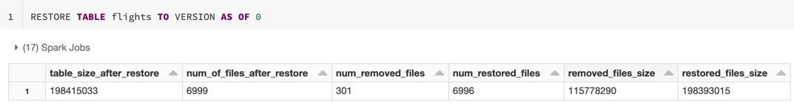
<sub>Official. RESTORE re-adds old files and removes newer ones in one commit, so you can undo the restore too. Source: [Databricks docs · History and data retention](https://docs.databricks.com/aws/en/delta/history)</sub>

<details><summary>🤔 <b>Your call:</b> could you restore to 12 days ago?</summary>

Not by default. Time travel needs the old **data files**, which are kept for 7 days (`delta.deletedFileRetentionDuration`). On UC managed tables, queries older than that are blocked even before `VACUUM` runs. See section 8.
</details>

**Step 5 · Publish Gold (catalog).** Analysts want revenue that matches Bronze **the moment** they query, and the query is light. So use a **plain view**: it stores no data and is always fresh. A materialized view refreshes on a schedule, so it lags (your diagnostic Q6).

```sql
CREATE OR REPLACE VIEW main.gold.daily_vendor_revenue AS
SELECT vendor_id, CAST(order_ts AS DATE) AS order_date, SUM(amount) AS revenue
FROM main.bronze.vendor_orders
GROUP BY ALL;

GRANT USE SCHEMA ON SCHEMA main.gold TO `analysts`;      -- USE CATALOG on main: default for everyone
GRANT SELECT     ON VIEW   main.gold.daily_vendor_revenue TO `analysts`;
```

| | Plain view | Materialized view |
|---|---|---|
| Stores data? | No, only the SQL | Yes, precomputed results |
| Freshness | Always current | As of the last refresh |
| Pick when | The query is light and freshness matters | The query is heavy, read often, and lag is OK |

Older: [W46 DB3 Gold layer objects](../../weekly-study/2026-W46-gold-objects-and-jobs/DB3-gold-layer-objects.md) · [W47 DB1 streaming tables vs MVs](../../weekly-study/2026-W47-lakeflow-pipelines-and-jobs/DB1-sdp-streaming-tables-vs-mvs.md).

**Step 6 · Friday's cleanup script (lifecycle).**

| Action | Result |
|---|---|
| `DROP VOLUME main.landing.vendor_raw` (external) | The volume is gone; **the files stay** in the vendor's bucket |
| `DROP TABLE main.bronze.vendor_orders` (managed) | `UNDROP TABLE` restores data, history and grants within **7 days**; after that the files are purged |
| `DROP VIEW main.gold.daily_vendor_revenue` | Only the SQL is lost |
| A legacy external Delta table that only Databricks writes to | `ALTER TABLE … SET MANAGED` keeps the name, grants and history, with a 14-day rollback window |

> ✅ `RESTORE` undoes a *change* to a table that still exists. `UNDROP` undoes a *delete*.

**Takeaway:** the same four layers answer every step: where the files live, which engine runs, what the log allows, and who can see the result.

---

## 8. Safety nets and lifecycle `§6` `§7`
*~7 min*

Every recovery tool has a clock.

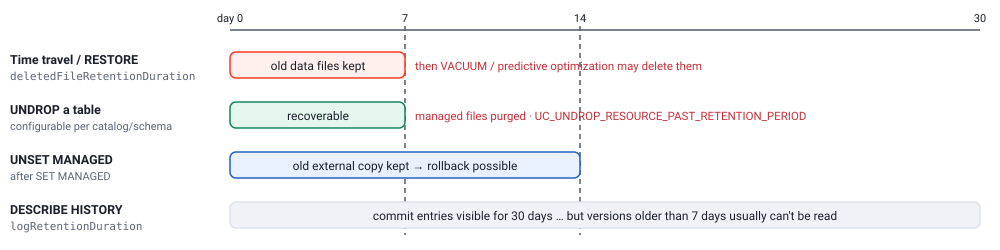
<sub>Diagram drawn for this deep dive.</sub>

| Tool | Fixes | Needs | Gotcha |
|---|---|---|---|
| `VERSION AS OF` / `TIMESTAMP AS OF` | Lets you look at the past | The old log entries and the old data files | Blocked past `deletedFileRetentionDuration` on UC managed tables |
| `RESTORE TABLE … TO VERSION AS OF n` | A bad change on a table that still exists | The table exists and v*n*'s files are still there | It's a new commit; history keeps the whole story |
| `UNDROP TABLE` (also `WITH ID`) | A dropped UC table, managed or external | The recovery period (7 days by default) hasn't passed, and the parent schema exists | Grants and history come back, but **not** PK/FK constraints. An external table also needs `CREATE EXTERNAL TABLE` on its location |
| `VACUUM` | Storage cost and compliance deletes | Files unreferenced for more than 7 days | Shortens time travel. Retention below 7 days fails with `DELTA_VACUUM_RETENTION_PERIOD_TOO_SHORT` |
| `SET MANAGED` / `UNSET MANAGED` | Moves an external table to managed in place | DBR 17.3 LTS+ or serverless | Writes pause briefly. Run `UNSET MANAGED` before you ever drop the table inside the window |

### VACUUM vs time travel
- **Two clocks:**
  - `logRetentionDuration` (30 days) sets how long *history entries* live.
  - `deletedFileRetentionDuration` (7 days) sets how long *removed data files* live.
  - Reading an old version needs both.
- **Want 30 days of time travel?** Raise both settings, before the files are gone, and accept the higher storage cost.
- **`VACUUM` modes:**
  - `DRY RUN` previews what would be deleted.
  - `LITE` is faster because it reads only the log.
  - `FULL`, the default, also catches orphans from aborted writes.

```sql
ALTER TABLE main.bronze.vendor_orders SET TBLPROPERTIES (
  'delta.deletedFileRetentionDuration' = 'interval 30 days',
  'delta.logRetentionDuration'         = 'interval 30 days');
VACUUM main.bronze.vendor_orders DRY RUN;
SHOW TABLES DROPPED IN main.bronze;
UNDROP TABLE main.bronze.vendor_orders;
```

### Predictive optimization
- It runs `OPTIMIZE`, `VACUUM` and `ANALYZE` automatically on **UC managed tables only**. External tables aren't eligible, which is why P3 W4 used `SET MANAGED`.
- It's on by default. You set it at the account level; catalogs, schemas and tables inherit it, and each level can override it.
- It's billed as serverless jobs, and it doesn't run `ZORDER`.
- **Consequence:** `VACUUM` really runs on your managed tables, so the 7-day time-travel limit is real, not theoretical.

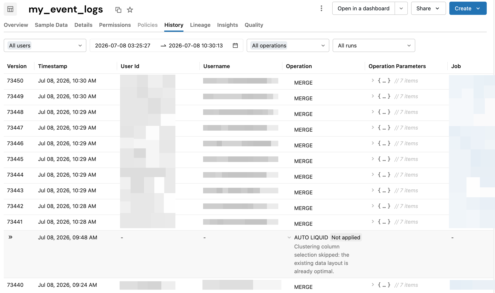
<sub>Official. Automatic runs show up in table history next to your own commits. Source: [Databricks docs · Predictive optimization](https://docs.databricks.com/aws/en/optimizations/predictive-optimization)</sub>

<details><summary>🤔 <b>Your call (P3 W3 again):</b> someone dropped the managed table <code>main.silver.customers</code> yesterday. RESTORE or UNDROP?</summary>

**`UNDROP TABLE main.silver.customers`.** `RESTORE` rolls back a table that still *exists*; on a dropped table it fails with `TABLE_OR_VIEW_NOT_FOUND`. If a new table has already taken the name, rename that one first, or use `SHOW TABLES DROPPED` and then `UNDROP TABLE WITH ID`.
</details>

Older note: [Delta time travel and retention](../../explanations/delta-time-travel-and-retention.md).

**Takeaway:** data files and `UNDROP` last 7 days, `UNSET MANAGED` 14 days, and history entries 30 days. `RESTORE` undoes a change; `UNDROP` undoes a delete.

---

## 9. When it breaks: errors to recognise `§6`
*~4 min*

Every row below is a real Databricks error class. Name the layer first; the fix is almost always in that layer.

| You see | Layer | Usual cause | Fix |
|---|---|---|---|
| `INSUFFICIENT_PERMISSIONS` on a `SELECT` | Catalog | `USE SCHEMA` / `USE CATALOG` is missing, or the view owner lost `SELECT` on the source | Check `SHOW GRANTS` and open the gates |
| `INSUFFICIENT_PERMISSIONS_EXT_LOC` on `CREATE TABLE … LOCATION` | Storage | No `CREATE EXTERNAL TABLE` on the external location | Grant it on the location (P3 W2) |
| `LOCATION_OVERLAP` | Storage | The path overlaps another external table, volume or managed root | Use a distinct sub-path |
| `TABLE_OR_VIEW_NOT_FOUND` on `RESTORE` | Catalog | The table was dropped | Use `UNDROP TABLE` |
| `UC_UNDROP_RESOURCE_PAST_RETENTION_PERIOD` | Catalog | The table was dropped longer ago than the recovery period | Rebuild it from the raw files (step 1) |
| `DELTA_UNSUPPORTED_TIME_TRAVEL_BEYOND_DELETED_FILE_RETENTION_DURATION` | Delta log | The version you asked for is older than the file retention | Raise retention *ahead of time* |
| `DELTA_VACUUM_RETENTION_PERIOD_TOO_SHORT` | Delta log | `VACUUM … RETAIN` is below the safety check | Keep it at 7 days or more |
| `DELTA_CONCURRENT_APPEND` (ConcurrentAppendException) | Delta log | A MERGE or UPDATE read files that a concurrent append changed | Narrow the predicates, separate the schedules, or retry |
| `DELTA_FILE_NOT_FOUND` | Storage | Someone deleted data files directly in S3 | Never touch table folders by hand |
| `INFINITE_STREAMING_TRIGGER_NOT_SUPPORTED` | Compute | A stream on serverless uses the default trigger | Use `.trigger(availableNow=True)` |

**Toolkit:**
- `DESCRIBE HISTORY`: who changed what, and when.
- `DESCRIBE DETAIL`: location, files, size and features.
- `DESCRIBE TABLE EXTENDED`: MANAGED or EXTERNAL, owner and location.
- `SHOW GRANTS`: the grants at each level.
- `SHOW TABLES DROPPED`: what `UNDROP` can still bring back.
- Query profile: the serverless stand-in for the Spark UI.
- `system.billing.usage`: DBUs per workload.

> ⏸ **Pause point 2.** The content part is done (~45 min). What's left is practice.

---

## 10. Hands-on (optional), Databricks Free Edition
*~10 min*

Create a notebook, attach **serverless**, and set the default language to SQL. Free Edition has no external locations, so the landing zone here is a **managed** volume.

*The expected results below were worked out by hand from this data, not run on a workspace. If a number differs, trust the workspace.*

```sql
-- Cell 1
USE CATALOG workspace;
CREATE SCHEMA IF NOT EXISTS dd_w1;
USE SCHEMA dd_w1;
CREATE VOLUME IF NOT EXISTS landing;
```

```python
# Cell 2 (%python)
base = "/Volumes/workspace/dd_w1/landing/orders"
dbutils.fs.put(f"{base}/day1.csv",
  "order_id,vendor_id,order_ts,amount\n"
  "1,41,2026-11-18 09:00:00,120.50\n2,42,2026-11-18 10:15:00,80.00\n3,42,2026-11-18 11:30:00,35.25\n", True)
dbutils.fs.put(f"{base}/day2.csv",
  "order_id,vendor_id,order_ts,amount\n"
  "4,41,2026-11-19 08:05:00,60.00\n5,43,2026-11-19 09:40:00,99.90\n6,42,2026-11-19 12:10:00,15.75\n", True)
display(dbutils.fs.ls(base))                  # 2 files
```

```sql
-- Cell 3
CREATE OR REPLACE TABLE bronze_vendor_orders AS
SELECT order_id, vendor_id, order_ts, CAST(amount AS DECIMAL(10,2)) AS amount,
       _metadata.file_path AS source_file, current_timestamp() AS ingested_at
FROM read_files('/Volumes/workspace/dd_w1/landing/orders/', format => 'csv', header => true);
SELECT count(*) AS n, sum(amount) AS total FROM bronze_vendor_orders;   -- 6 | 411.40
DESCRIBE TABLE EXTENDED bronze_vendor_orders;                           -- Type: MANAGED

-- Cell 4
UPDATE bronze_vendor_orders SET amount = 0 WHERE vendor_id = 42;
SELECT sum(amount) FROM bronze_vendor_orders;                     -- 280.40
DESCRIBE HISTORY bronze_vendor_orders;                            -- v0 CTAS, v1 UPDATE
SELECT sum(amount) FROM bronze_vendor_orders VERSION AS OF 0;     -- 411.40
RESTORE TABLE bronze_vendor_orders TO VERSION AS OF 0;            -- history: v2 RESTORE

-- Cell 5
CREATE OR REPLACE VIEW gold_daily_vendor_revenue AS
SELECT vendor_id, CAST(order_ts AS DATE) AS order_date, SUM(amount) AS revenue
FROM bronze_vendor_orders GROUP BY ALL;
SELECT * FROM gold_daily_vendor_revenue ORDER BY order_date, vendor_id;
-- 5 rows: 11-18 → 41: 120.50, 42: 115.25 · 11-19 → 41: 60.00, 42: 15.75, 43: 99.90

-- Cell 6 (one line at a time)
DROP TABLE bronze_vendor_orders;
SELECT * FROM gold_daily_vendor_revenue;                  -- fails: source gone
RESTORE TABLE bronze_vendor_orders TO VERSION AS OF 0;    -- fails: TABLE_OR_VIEW_NOT_FOUND
SHOW TABLES DROPPED IN dd_w1;
UNDROP TABLE bronze_vendor_orders;
SELECT count(*) FROM gold_daily_vendor_revenue;           -- 5 again

-- Cell 7
VACUUM bronze_vendor_orders DRY RUN;                      -- likely 0 files
VACUUM bronze_vendor_orders RETAIN 0 HOURS;               -- DELTA_VACUUM_RETENTION_PERIOD_TOO_SHORT
DROP SCHEMA dd_w1 CASCADE;
```

---

## 11. Scenario check (11 questions)
*~8 min · answers at the bottom*

Reply with your answers (e.g. `Q1 B, Q2 C …`); misses go into Monday's review, tagged by section.

**Q1.** `§7` The vendor will keep writing CSVs to their own bucket. Engineers must list and read those files by a Unity Catalog path, with UC privileges. What do you create?
- A) A managed volume in main.landing, then copy the files into it
- B) An external volume on a path under an external location
- C) An external table with LOCATION set to the vendor's folder
- D) A storage credential granted directly to each engineer

**Q2.** `§1` A nightly Python task needs a compute-scoped init script that installs an OS-level package. Which compute fits?
- A) Serverless jobs compute with a larger environment
- B) A serverless SQL warehouse running the task as SQL
- C) Classic jobs compute with dedicated access mode
- D) Serverless notebook compute plus %pip install

**Q3.** `§2 §3` You load Bronze with `CREATE TABLE main.bronze.vendor_orders AS SELECT … FROM read_files('/Volumes/main/landing/vendor_raw/orders/')`. What kind of table is it?
- A) Managed, because no LOCATION clause was given
- B) External, because the source volume is external
- C) External, because its source files sit in a volume
- D) Managed, but only after you run SET MANAGED on it

**Q4.** `§6` A job crashes halfway through an `INSERT` into a Delta table while analysts are querying it. What do analysts see?
- A) The last committed version, without the new rows
- B) The rows written before the crash, until a repair
- C) An error until someone runs FSCK REPAIR TABLE
- D) A mix of old and new rows across the data files

**Q5.** `§3` Analysts want vendor revenue that always matches Bronze the moment they query it. The query is light. Which object fits best?
- A) A materialized view refreshed every hour
- B) A plain view over the Bronze table
- C) A managed table rebuilt by a nightly job
- D) A streaming table reading from Bronze

**Q6.** `§7` An analyst has `SELECT` on `main.gold.daily_vendor_revenue` but still gets INSUFFICIENT_PERMISSIONS. The view owner's grants on Bronze are fine. What's the most likely gap?
- A) MODIFY granted on the view itself
- B) READ VOLUME on the landing volume
- C) USE SCHEMA on the main.gold schema
- D) CREATE TABLE on the main.gold schema

**Q7.** `§6` Two nightly jobs run plain `INSERT INTO main.bronze.vendor_orders` at the same moment. Neither reads the table first. What happens?
- A) The second always fails with ConcurrentAppendException
- B) Their new rows are merged into one shared commit file
- C) The table stays locked until the first job finishes
- D) Both succeed; the loser retries as the next version

**Q8.** `§6` Bronze has default retention settings and predictive optimization is on. An auditor asks to query the table as of 12 days ago. What happens?
- A) It works, since the log keeps 30 days of history entries
- B) It's blocked: old data files are kept 7 days by default
- C) It works, but only from a SQL warehouse, not serverless
- D) It works once you RESTORE the table to that version

**Q9.** `§7` The metastore root is `s3://acme-uc/root/`, catalog `main` has MANAGED LOCATION `s3://acme-uc/main/`, and schema `main.bronze` has MANAGED LOCATION `s3://acme-uc/bronze/`. Where do a new managed table's files go?
- A) Under the metastore root, since it sits at the top
- B) Under the catalog root, since catalogs isolate data
- C) Under the schema root, as the most specific one
- D) In the vendor's bucket, next to the source CSV files

**Q10.** `§7` Last week you ran `ALTER TABLE … SET MANAGED` on `main.bronze.legacy_events`. A non-Databricks reader still reads the old S3 path directly and now sees stale data. What's the quickest safe way back, within the window?
- A) Run UNDROP TABLE to bring back the external version
- B) Run ALTER TABLE … UNSET MANAGED on the table
- C) Run RESTORE TABLE to the version before conversion
- D) DEEP CLONE the managed table back to the old path

**Q11.** `§7` You ran `GRANT USE SCHEMA, SELECT ON SCHEMA main.gold TO analysts`. Next month someone creates the view `main.gold.weekly_kpis`. Can analysts query it?
- A) No, every new view needs its own SELECT grant
- B) Only after its owner runs GRANT on the new view
- C) Only once a metastore admin approves the view
- D) Yes, schema grants cover objects created later

---

## 12. Interview questions

Say each answer out loud first (about a minute), then open it.

<details><summary><b>Q1.</b> Walk me through how you'd onboard a new vendor file feed into the lakehouse.</summary>

I start with **ownership**. The vendor owns the files, so I govern them in place: a storage credential and an external location (usually admin-owned), then an **external volume** over their folder. That way engineers use `/Volumes` paths and UC grants, never raw keys.

I load into a **managed Bronze** Delta table with lineage columns (source file, ingest time). The platform then handles layout, predictive optimization and `UNDROP`. The load is incremental (Auto Loader or `COPY INTO`) and runs as a serverless job. Gold is a view or table with least-privilege grants. I keep the raw files replayable, because that's my real backup.

*Why it sounds senior: it opens with an ownership decision, names the recovery story, and separates governing files from owning tables.*
</details>

<details><summary><b>Q2.</b> Managed or external tables: what's your default, and when do you go external?</summary>

**Managed by default.** UC owns the files, which gives me:
- automatic maintenance through predictive optimization;
- clean drop and undrop semantics;
- no path sprawl.

I go **external** when something outside Databricks must *write* those files at a path I don't control, or when the data has to stay at a fixed location for contractual reasons. When that outside writer goes away, I convert with `SET MANAGED`, which keeps the name, grants and history and allows a 14-day `UNSET MANAGED` rollback.

*Why it sounds senior: a clear default, a specific exception, and a migration path with its rollback.*
</details>

<details><summary><b>Q3.</b> Object storage has no transactions. How does Delta give you ACID on it?</summary>

Through the **transaction log**:
- Data files are immutable Parquet.
- Each change is one numbered JSON commit that lists the files added and removed.
- A commit is **one atomic put-if-absent** of the next version file. It either exists or it doesn't, so readers never see half a write.
- Writers use **optimistic concurrency**. A writer reads a snapshot, writes its files, and tries to claim the next version. If someone else got there first, it checks for logical conflicts, then retries or fails.
- Readers get snapshot isolation, and Parquet checkpoints keep reconstruction fast.

*Why it sounds senior: it names the primitive (atomic file creation) instead of saying "Delta handles it".*
</details>

<details><summary><b>Q4.</b> "We have time travel, so we don't need backups." How do you respond?</summary>

Time travel is an **undo button, not a backup**:
- Removed files are kept for 7 days by default, and on managed tables predictive optimization really runs `VACUUM`.
- History entries last 30 days, but an entry whose files are gone can't be read.
- A dropped table is recoverable for 7 days.
- Everything sits in the same storage account, so none of this protects against account-level mistakes.

For real backups, I keep the raw input replayable, `DEEP CLONE` critical tables to another location on a schedule, and raise retention deliberately where the business needs a longer undo.

*Why it sounds senior: it knows the actual clocks and separates undo from disaster recovery.*
</details>

<details><summary><b>Q5.</b> An analyst says "I can't read the revenue view." How do you debug it?</summary>

I read the **error class** first, then work down a checklist:
1. `TABLE_OR_VIEW_NOT_FOUND` can mean the object just isn't visible to them, so I check the usage gates: `USE CATALOG` and `USE SCHEMA` on every parent.
2. With `SHOW GRANTS`, I check `SELECT` on the view itself, direct or inherited.
3. I confirm the grant went to a group the analyst is actually in.
4. If the view fails for everyone, the **view owner** probably lost `SELECT` on the source, because views run with the owner's rights.

For discovery problems I grant `BROWSE`; to find who changed what, I check the audit system table.

*Why it sounds senior: a top-down checklist, plus the view-owner subtlety.*
</details>

---

## 13. Cheat sheet

**The split that decides everything:** if the *files* have an outside owner, go external (location + volume). If your pipeline owns the *table*, go managed.

| Platform + compute §1 | Unity Catalog + storage §7 §2 | Delta + safety §1 §6 |
|---|---|---|
| Control plane: web app, jobs, **UC**, queries. Compute plane: classic (your account) or serverless (Databricks') | `catalog.schema.object`, one metastore per region | Commit = one atomic JSON in `_delta_log`. No commit → no change |
| **Serverless** is the default for notebooks and jobs. **SQL warehouse** is for SQL/BI only | Credential → **external location** (credential + path) → external tables, volumes and managed roots | Parquet checkpoints speed up reads. Blind appends never conflict |
| **Classic** when you must configure compute: init scripts, most Spark confs, RDD API, pools, policies, runs over 7 days | Managed data root: **schema > catalog > metastore**. Paths can't overlap | `RESTORE` undoes a **change**. `UNDROP` undoes a **delete** (7 days) |
| Python deps on serverless come from `%pip` or the environment | Read = `USE CATALOG` + `USE SCHEMA` + `SELECT`. Container grants inherit to current and future children | Files are kept **7 days** (`deletedFileRetentionDuration`) and history **30 days** (`logRetentionDuration`). Time travel needs both |
| No Spark UI on serverless → **query profile**. Streams use `availableNow` | Volumes govern files at `/Volumes/c/s/v/…` and are never registered as tables | Predictive optimization runs OPTIMIZE, VACUUM and ANALYZE on **managed tables only** |
| | An external table at a path needs `CREATE EXTERNAL TABLE` on the location | `SET MANAGED` keeps the name, grants and history. `UNSET MANAGED` works for 14 days |

**🚩 Exam traps**
- Serverless limits are about **configuring the compute**, not Python vs SQL.
- Source files in a volume don't make a table external. Only `LOCATION` does.
- `SELECT` alone isn't enough to read, and `MODIFY` never helps a read.
- Everyone has `USE CATALOG` on `main` by default.
- `RESTORE` on a dropped table fails; use `UNDROP`.

**Don't confuse**
- **Plain view** (SQL only, always fresh) vs **MV** (stored, refresh lag).
- **Managed volume** (drop deletes after 7 days) vs **external volume** (files stay).
- **DROP external table** (files stay) vs **DROP managed table** (`UNDROP` for 7 days, then purge).
- **VACUUM LITE** (reads only the log) vs **VACUUM FULL** (also removes orphans from crashes).
- **BROWSE** (see that it exists) vs **SELECT** (read the data).

**Self-test (answer out loud)**
1. Where do a managed table's files go if only the catalog has a root?
2. Two blind appends collide. What happens?
3. An auditor wants the table as of day −12. Is that possible by default?
4. A job needs an init script. Which compute?
5. An analyst has SELECT but no access. Why?

*Answers: 1 the catalog root · 2 both commit · 3 no, files are kept 7 days · 4 classic jobs compute · 5 missing USE SCHEMA*

---

## 14. Connections and go deeper

| This week's idea | Comes back in | How |
|---|---|---|
| Volumes and replayable raw files | **W2 Ingestion** | `COPY INTO` and Auto Loader read `/Volumes` paths and load only new files. Older: [W43 deep dive: governed ingestion to Bronze](../../weekly-study/2026-W43-ingestion-into-bronze/deepdive-db-governed-ingestion-to-bronze.html) |
| Managed Bronze + `_rescued_data` | W2 Wed, W3 | Schema inference, evolution and rescued data, then cleaning into Silver |
| Plain view vs MV | W4 Tue | Gold objects: table vs view vs MV vs streaming table |
| Data-skipping stats, predictive optimization, query profile | W4 Fri | "Why is it slow?": file layout, liquid clustering, tuning |
| Serverless vs classic jobs compute | W5 | Lakeflow Jobs task compute and cluster startup failures |
| Concurrent writers | W5 Fri | Two jobs hitting one table; safe-to-retry design |
| Grants and inheritance | W6 | GRANT/REVOKE, row filters, column masks, ABAC |

**Your older material:**
- [Platform wrap: Delta, Unity Catalog and compute](../../explanations/platform-delta-unity-catalog-compute.md)
- [ACID on Delta](../../explanations/acid-on-delta.md) · [Delta time travel and retention](../../explanations/delta-time-travel-and-retention.md)
- [UC volumes and external locations](../../explanations/unity-catalog-volumes-and-external-locations.md) · [Medallion architecture](../../explanations/medallion-architecture.md)
- This week's pills: [P1](P1-delta-acid-and-the-lakehouse.md) · [P2](P2-compute-and-storage-compute-separation.md) · [P3](P3-unity-catalog-managed-vs-external-tables.md)

**Official docs (each opened on 2026-11-22):**
- **Platform and compute:** [High-level architecture](https://docs.databricks.com/aws/en/getting-started/high-level-architecture) · [Serverless limitations](https://docs.databricks.com/aws/en/compute/serverless/limitations) · [Choose compute](https://docs.databricks.com/aws/en/compute/choose-compute)
- **Unity Catalog and permissions:** [What is Unity Catalog?](https://docs.databricks.com/aws/en/data-governance/unity-catalog/) · [Permissions concepts](https://docs.databricks.com/aws/en/data-governance/unity-catalog/access-control/permissions-concepts) · [Privileges reference](https://docs.databricks.com/aws/en/data-governance/unity-catalog/manage-privileges/privileges)
- **Storage and volumes:** [External locations](https://docs.databricks.com/aws/en/connect/unity-catalog/cloud-storage/external-locations) · [Managed storage](https://docs.databricks.com/aws/en/connect/unity-catalog/cloud-storage/managed-storage) · [Volumes](https://docs.databricks.com/aws/en/volumes/) · [read_files](https://docs.databricks.com/aws/en/sql/language-manual/functions/read_files)
- **Delta history and concurrency:** [History and retention](https://docs.databricks.com/aws/en/delta/history) · [VACUUM](https://docs.databricks.com/aws/en/delta/vacuum) · [Isolation and write conflicts](https://docs.databricks.com/aws/en/delta/concurrency-control)
- **Table lifecycle:** [Managed tables](https://docs.databricks.com/aws/en/tables/managed) · [UNDROP](https://docs.databricks.com/aws/en/sql/language-manual/sql-ref-syntax-ddl-undrop-table) · [SET MANAGED](https://docs.databricks.com/aws/en/tables/convert-external-managed) · [Predictive optimization](https://docs.databricks.com/aws/en/optimizations/predictive-optimization)
- **Reference:** [Error classes](https://docs.databricks.com/aws/en/error-messages/error-classes) · [Blog: Unpacking the transaction log](https://www.databricks.com/blog/2019/08/21/diving-into-delta-lake-unpacking-the-transaction-log.html) · [Exam page](https://www.databricks.com/learn/certification/data-engineer-associate)

*Optional, not homework:* [kengio study guide: DE Associate](https://github.com/kengio/databricks-certification-study-guide/tree/main/certifications/data-engineer-associate)

> ✅ **Last step, 1 minute:** close this page and write down the three things you remember most. Then reply with your scenario-check answers.

---

## Scenario check answers

<details><summary>Open only after answering</summary>

**Q1 → B** (§7). The files have an outside writer, so you govern them in place.
- A) Copying breaks "govern in place", and the vendor can't write into UC managed storage.
- C) A table governs rows, not files, so there's no `/Volumes` file access.
- D) Credentials define external locations; they aren't handed to users.

**Q2 → C** (§1). Serverless doesn't run compute-scoped init scripts.
- A) A bigger environment still can't run init scripts.
- B) A SQL warehouse runs SQL only.
- D) `%pip` installs Python packages, not OS-level setup.

**Q3 → A** (§2 §3). No `LOCATION` (and no `.option("path")`) means managed.
- B) and C) Both mix up the source with the table's own storage.
- D) `SET MANAGED` is for tables that are already external.

**Q4 → A** (§6). A write is visible only once its commit lands.
- B) Partial writes are never referenced by a commit.
- C) FSCK is for data files deleted by hand.
- D) Readers always see one snapshot.

**Q5 → B** (§3). A plain view is always fresh, and the query is light.
- A) Up to an hour of lag.
- C) Up to a day of lag.
- D) Streaming tables are for incremental ingestion and keep a copy of the data.

**Q6 → C** (§7). USE SCHEMA is the missing gate; USE CATALOG on `main` is a default for everyone.
- A) MODIFY is for writes.
- B) The view reads a table, and it uses its owner's rights.
- D) CREATE TABLE is for new objects.

**Q7 → D** (§6). Under WriteSerializable, blind appends never conflict; the loser retries as N+1.
- A) Concurrent-append errors need an operation that *read* the changed data.
- B) Each write gets its own commit.
- C) Delta doesn't lock tables.

**Q8 → B** (§6). Data files are kept for 7 days; predictive optimization vacuums, and UC managed tables block older reads.
- A) The 30-day log holds entries, not files.
- C) Retention is a table property, so the compute doesn't matter.
- D) RESTORE needs the same files.

**Q9 → C** (§7). Managed storage resolves schema → catalog → metastore.
- A) The metastore root is only the fallback.
- B) The catalog root is used only when the schema has none.
- D) Source files never decide where a managed table lives.

**Q10 → B** (§7). `UNSET MANAGED` points the table back at its external location within 14 days.
- A) Nothing was dropped.
- C) RESTORE changes contents, not location.
- D) A clone is a second table you'd have to keep in sync.

**Q11 → D** (§7). Container grants inherit to current **and future** children.
- A) That was the pre-2022 privilege model.
- B) Not needed; the schema grant already covers it.
- C) There's no approval step.

</details>

*Reply with your answers (e.g. `Q1 B, Q2 C …`). Misses go into Monday's Week 2 review, tagged by exam section.*
